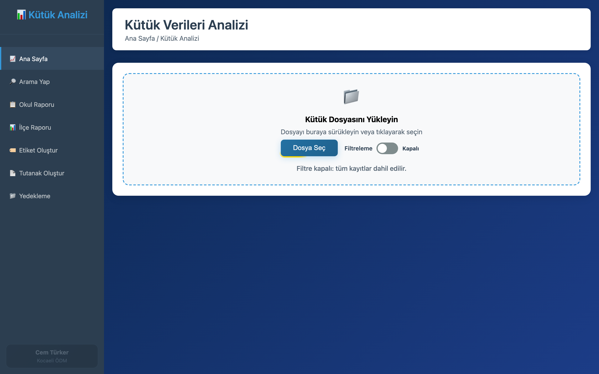

# 📊 Excel Kütük Analizi

> A single-file web app that turns school registry Excel files into statistics, searchable tables, printable labels and official minutes — entirely in the browser.

[](#project-structure)
[](#privacy)
[](LICENSE)

<p align="center">
  <a href="https://www.buymeacoffee.com/cmtrkr"></a>
</p>

Excel Kütük Analizi is a Turkish-language tool for district education offices and school administrators. Drop in a `.xlsx` or `.xls` registry export and the app parses it locally, builds district and school statistics, lets you search every column, and generates A4-ready school labels and delivery minutes.

Everything — HTML, CSS, JavaScript, parsing and charting — lives in one `index.html` file. Uploaded data never leaves the browser.

## 📸 Screenshot

<p align="center">
  
  <br>
  <sub>The real app before a file is loaded: module sidebar, upload area and special-education filter.</sub>
</p>

## ✨ Features

- 📥 **Excel import** — drag-and-drop or file picker for `.xlsx` and `.xls`, with a progress indicator.
- 💾 **Large datasets** — IndexedDB-backed SQL storage with JSON backup.
- 📈 **Statistics cards** — schools, students, districts, official/private institutions, branches and special-education counts.
- 🔎 **Search** — all columns or a selected column, paginated 50 rows at a time, exportable to Excel.
- 🏫 **School report** — district/school filters, branch details and A4 class-list printing.
- 🏛️ **District report** — per-district summary, printing and Excel export.
- 🏷️ **Labels** — school or branch labels, scope selection, custom grid, 10 background colors and A4 preview.
- 📄 **Delivery minutes** — centre → district and district → school templates, with date, title and preparer fields.
- 🧹 **Special-education filter** — include or exclude special-education classes and see the excluded counts.
- 🗃️ **Backup** — download all data as JSON.

## 🚀 Usage

No installation or build step is required.

1. Open `index.html` in Chrome, Edge or Firefox.
2. Drop a registry Excel file onto the upload area.
3. Choose a module from the sidebar:
   - **Ana Sayfa** — statistics and charts
   - **Arama Yap** — search and export
   - **Okul Raporu** — school and branch reports
   - **İlçe Raporu** — district summary
   - **Etiket Oluştur** — labels
   - **Tutanak Oluştur** — delivery minutes
   - **Yedekleme** — JSON backup
4. Use the browser's print dialog for A4 output.

You can also serve the folder:

```bash
python3 -m http.server 8080
# open http://localhost:8080
```

## 📁 Project structure

```text
SP-kutuk-islemleri/
├── index.html          # Entire application: HTML + CSS + JS
├── public/index.html   # Deployment copy used by Cloudflare
├── favicon.png
└── wrangler.toml       # Optional static deployment
```

The application loads XLSX.js, Chart.js and sql.js from a CDN, so the first open needs an internet connection. Parsed data is then stored locally in IndexedDB.

## 🔐 Privacy

- Files are parsed in the browser and are **not uploaded** to a server.
- Registry data stays in the browser profile's IndexedDB/localStorage.
- Use **Yedekleme** before clearing browser data.
- Print and export operations happen locally.

## 🌐 Deployment

The repository includes a `wrangler.toml` for Cloudflare static hosting. Deploy the `public/` folder, or host `index.html` on any static server. For fully offline use, download the CDN libraries and reference them locally.

## ⚠️ Notes

- The UI and reports are in Turkish and follow Turkish education terminology.
- Column detection expects a typical registry layout; unusual files may need manual adjustment.
- Test print layouts in your browser before printing large batches.
- This is not an official Ministry of National Education product.

## ❤️ Support

If this tool saves you hours of Excel work, you can buy me a coffee:

<p align="center">
  <a href="https://www.buymeacoffee.com/cmtrkr"></a>
</p>

## 📄 License

[MIT](LICENSE) © 2026 Cem Türker.
